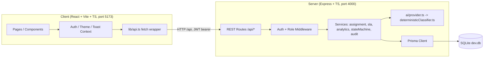
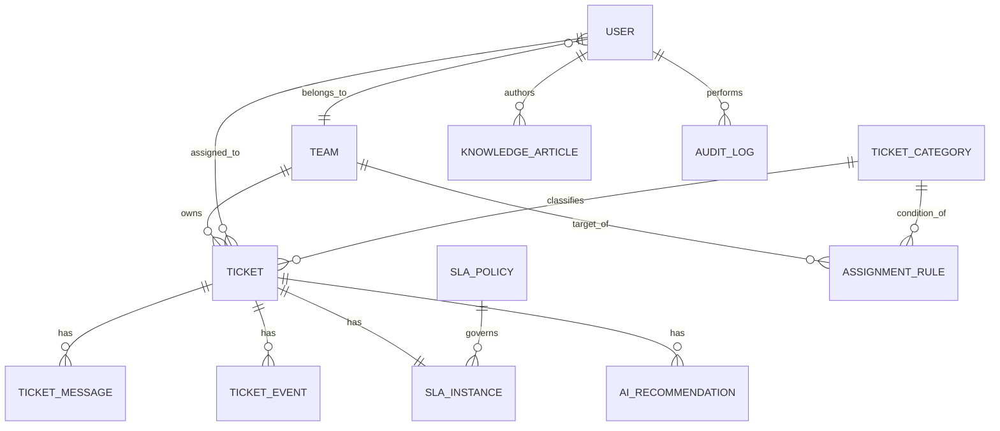
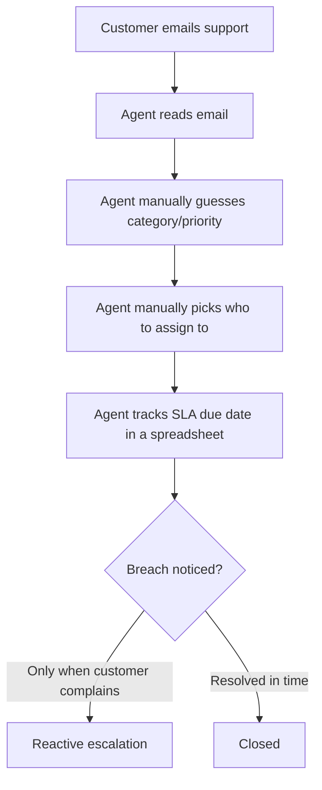
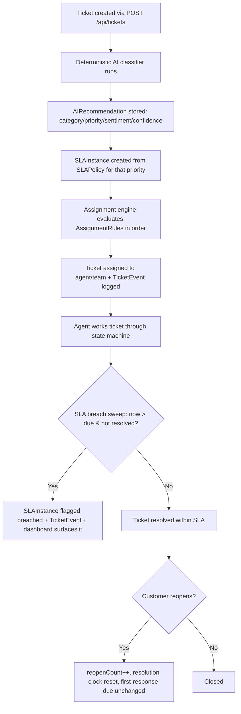

# TicketSense — Architecture

## 1. System Architecture

In development, Vite proxies `/api/*` to the Express server (see
`client/vite.config.ts`), so the browser only ever talks to one origin.

## 2. Entity-Relationship Diagram

Full field-level definitions live in `server/prisma/schema.prisma` — the
single source of truth. Enum-like fields (role, status, priority, etc.)
are modeled as `String` columns because SQLite's Prisma connector has no
native enum type (see ADR below); valid values are enforced by Zod and
documented as TypeScript literal unions in `server/src/types/enums.ts`.

## 3. Architecture Decision Records

### ADR-1: SQLite + Prisma over Postgres for the MVP
**Decision:** Use SQLite (file-based) via Prisma as the only datastore.
**Why:** Zero external services to install/configure — `npm install && npm
run seed && npm run dev` is the entire setup. This is explicitly a
portfolio/demo constraint, not a production recommendation.
**Trade-off:** No native enums, no concurrent-write scaling, no
network-accessible DB. See `roadmap.md` for the documented Postgres
migration path (Prisma's schema/migration model makes the swap mechanical:
change the `datasource provider`, reintroduce native `enum` blocks, rerun
`prisma migrate dev`).

### ADR-2: Deterministic rule/keyword AI classifier as the default and only shipped path
**Decision:** `server/src/ai/deterministicClassifier.ts` implements
category/subcategory matching, sentiment scoring, and priority scoring via
keyword dictionaries — no external API call.
**Why:** The project must work with zero API keys, be fully reproducible
for tests and demos, and avoid hidden cost/latency/availability dependency
on a third party for a portfolio project.
**Trade-off:** Lower ceiling on classification quality than a real LLM for
novel phrasing. `server/src/ai/provider.ts` is the explicit seam for
plugging in a real provider later (see `roadmap.md`); it is not implemented
and falls back to the deterministic engine if misconfigured, by design.

### ADR-3: Enums modeled as validated strings, not Prisma native enums
**Decision:** Role/status/priority/etc. are `String` columns in the Prisma
schema, with the real enum defined once in `server/src/types/enums.ts` and
enforced by Zod in every route that accepts one as input.
**Why:** SQLite has no native enum support in Prisma 5.x; attempting to
declare one is a schema validation error.
**Trade-off:** The compiler won't catch an invalid string for
Prisma-returned data on its own — mitigated by casting at the few read
sites that need literal-type narrowing (e.g. `ticket.status as TicketStatus`
before calling the state-machine functions) and by Zod validating all
writes.

### ADR-4: In-process round-robin cursor, not a persisted counter
**Decision:** The round-robin assignment strategy keeps its "next agent"
cursor in an in-memory `Record<teamId, number>` inside
`assignmentService.ts`.
**Why:** Simplicity for the MVP; round robin only needs to be fair across a
single running process's lifetime for the purpose of this demo.
**Trade-off:** The cursor resets on server restart and would not be correct
across multiple horizontally-scaled server instances. A production version
would persist the cursor (e.g. a `lastAssignedAgentId` column on
`AssignmentRule`) or move to the least-active strategy, which is
state-free and restart-safe.

### ADR-5: JWT auth with roles embedded in the token
**Decision:** Login issues a signed JWT containing `sub`, `email`, `role`,
`name`; `requireAuth` verifies it, `requireRole(...)` checks the embedded
role against an allow-list per route.
**Why:** Stateless, no session store needed, matches the "no extra
infrastructure" constraint.
**Trade-off:** A role change does not take effect until the user's token
expires/re-logs-in (12h expiry). Acceptable for the MVP; a production
version would check role from the DB on each request or use short-lived
tokens with refresh.

## 4. Process Flow: Ticket Lifecycle (AS-IS vs TO-BE)

**AS-IS (the manual process TicketSense replaces):**

**TO-BE (implemented in TicketSense):**

