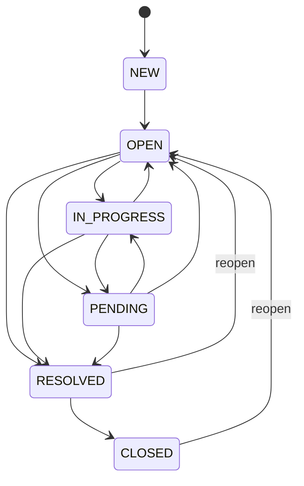

# TicketSense — Business Rules & SLA

## 1. Ticket State Machine

Implemented in `server/src/services/stateMachine.ts`. Any transition not in
this table is rejected by `POST /api/tickets/:id/status` with HTTP 400 and
the ticket's actual allowed next statuses in `error.details`.

## 2. SLA Calculation Rules

### 2.1 Business hours

Default org timezone: configurable via `ORG_TIMEZONE` (defaults to
`Asia/Kolkata`). Business hours: **Monday-Friday, 09:00-18:00, org-local
time**. An `SLAPolicy.businessHoursOnly = true` means due dates are
computed by walking forward only through business-hour windows (nights and
weekends do not count toward the target); `false` means the target is
simply added to wall-clock time (24x7), used for `CRITICAL` in the seed
data since a production-down issue doesn't wait for business hours.

Implementation: `server/src/lib/businessHours.ts`
(`addBusinessMinutes` / `addCalendarMinutes`), covered by
`server/tests/sla.test.ts`.

### 2.2 First-response and resolution targets (seeded defaults)

| Priority | First response target | Resolution target | Business hours only |
|---|---|---|---|
| LOW | 480 min (8h) | 4320 min (3 business days) | Yes |
| MEDIUM | 240 min (4h) | 1440 min (1 business day) | Yes |
| HIGH | 60 min (1h) | 480 min (8h) | Yes |
| CRITICAL | 15 min | 240 min (4h) | No (24x7) |

Configurable via `SLAPolicy` CRUD (`/api/sla/policies`).

### 2.3 Reopen behavior (documented rule)

When a ticket is reopened (`RESOLVED`/`CLOSED` -> `OPEN`):
- **`firstResponseDueAt` and `firstResponseBreached` are left unchanged.**
  The customer already received an initial response during the original
  lifecycle; re-measuring "time to first response" from the reopen moment
  would be misleading.
- **`resolutionDueAt` is recomputed from "now"**, using the same
  `SLAPolicy`'s `resolutionTargetMin`, and **`resolutionBreached` is reset
  to `false`**. The ticket is effectively back in active work and deserves
  a fresh resolution window.
- `Ticket.reopenCount` is incremented every time this transition occurs.

Implemented in `server/src/services/slaService.ts::handleReopen`, invoked
from `POST /api/tickets/:id/status` when the transition matches
`isReopenTransition`. Covered by `server/tests/tickets.test.ts`.

### 2.4 Breach detection

`POST /api/sla/run-breach-detection` (also usable as a scheduled job in a
real deployment) sweeps every ticket not in `RESOLVED`/`CLOSED` and, for
each one past its `firstResponseDueAt` or `resolutionDueAt` without the
corresponding "met" timestamp, sets the breach flag and logs a
`TicketEvent` of type `SLA_BREACH`. The dashboard's `slaBreached` KPI and
the SLA Management breach list both read these flags directly — there is
no separate "breach calculation" at render time.

## 3. Exception-Handling Matrix

| Exception | Handling |
|---|---|
| **Duplicate ticket submission** (same requester, same subject) | Not deduplicated automatically in the MVP — each `POST /tickets` creates a new ticket. Flagged in `roadmap.md` as a planned enhancement (duplicate detection via subject+requester+time-window heuristic). |
| **Agent unavailable / overloaded** | Assignment engine checks `activeTicketCount(agent) < agent.maxLoad` before considering a candidate; overloaded or inactive (`isActive=false`) agents are excluded. If no agent qualifies, `auto-assign` returns `agentId: null` with a reason string rather than silently failing. |
| **Assignment rule conflict** (two non-default rules both match) | Rules are evaluated **in `order` ascending**; the first match wins. There is no "most specific wins" resolution — rule order is the explicit conflict-resolution mechanism, and the UI exposes reordering via `/assignment-rules/reorder`. |
| **AI classifier / service failure** | The classifier is a pure, synchronous, in-process function with no I/O — it cannot fail due to network/availability. If a future real-LLM provider (see `architecture.md` ADR-2) were wired into `ai/provider.ts` and that call failed, the seam is designed to catch the error and fall back to the deterministic engine so ticket creation never blocks on AI. |
| **Low-confidence AI recommendation** | `confidence < 0.6` triggers an explicit "recommend manual review" sentence appended to `reasoning` (see `deterministicClassifier.ts`); the UI does not auto-apply low-confidence suggestions differently today, but surfaces the same confidence number and reasoning so an agent can judge it before accepting. |
| **Concurrent ticket updates** (two agents act on the same ticket) | Last-write-wins at the database layer (Prisma/SQLite row update) in the MVP; no optimistic-locking/version column. Flagged in `roadmap.md`. The activity timeline (`TicketEvent`) at least gives a full audit trail of who did what and when, even without conflict prevention. |
| **Unauthorized action** | Every mutating admin/manager-only route (`requireRole(...)`) returns `403 FORBIDDEN` server-side, independent of what the UI shows; every route requires a valid JWT (`401 UNAUTHORIZED` otherwise). Covered by `server/tests/authz.test.ts`. |
| **Invalid status transition** | Rejected with `400 BAD_REQUEST` and the actual allowed next statuses, never silently coerced. |
