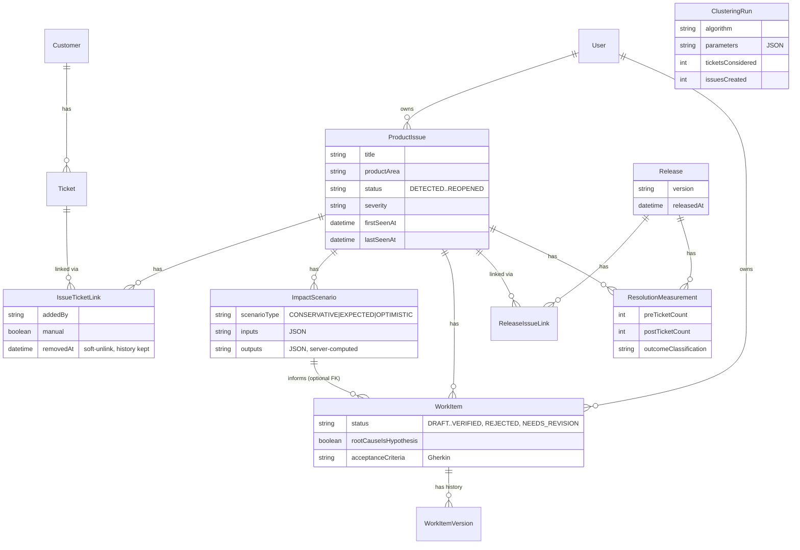

# TicketSense V2 — Product Intelligence Modules

This document covers the four V2 modules added on top of the V1 support-ops
platform described in `product-vision-and-brd.md` and `architecture.md`:
**Issue Genome**, **Fix Impact Simulator**, **Support-to-Roadmap Engine**, and
**Resolution Intelligence**. Each is a real, working, deliberately
scoped-down MVP — see `roadmap.md` for exactly what is Implemented vs.
Interactive Demo vs. Planned.

## 1. Data model (ERD extension)



Full field lists are in `server/prisma/schema.prisma` (search for the "V2 —
TicketSense Product Intelligence modules" section). `Customer` is new in V2:
tickets previously only had free-text `requesterName`/`requesterEmail`; most
tickets (~85% of seeded data) now also carry a `customerId` FK so "unique
affected customers" and "customer tier" are computed from real rows, not
guessed from email strings.

## 2. Similarity & clustering formula (Issue Genome)

Implemented in `server/src/ai/similarity.ts`. This is explicitly a
**similarity score**, never described as an AI "confidence" score, because it
is plain, deterministic set arithmetic — no model, no training data, no
external call.

1. Normalize: lowercase, strip punctuation, collapse whitespace.
2. Tokenize on whitespace; drop a ~60-word stopword list and tokens under 3
   characters.
3. Build the set of **word bigrams** (consecutive token pairs) for each
   ticket's `subject + ". " + description`. Bigrams capture short phrases
   ("otp delivery", "delivery failed") that single-token overlap would miss.
4. `similarity(A, B) = |bigrams(A) ∩ bigrams(B)| / |bigrams(A) ∪ bigrams(B)|`
   — the Jaccard index over the two bigram sets. Falls back to unigram
   Jaccard if either ticket has fewer than 2 significant tokens.
5. Two tickets are considered related when `similarity >= SIMILARITY_THRESHOLD`
   (currently **0.22**, see `SIMILARITY_THRESHOLD` in `similarity.ts`).

**Clustering**: a simple greedy union-find over every ticket pair above the
threshold (`clusterTickets()`). Any resulting group smaller than
`MIN_CLUSTER_SIZE` (currently **3**) is discarded — a pair of similar tickets
is not yet a "recurring problem," it might be coincidence. The "Detect
emerging issues" endpoint (`POST /api/issues/detect-clustering`) runs this
over tickets not yet linked to any issue, creates a `ProductIssue` per
cluster with status `DETECTED`, and records an audit `ClusteringRun` row
(algorithm name, parameters, tickets considered, issues created).

"Common symptoms" shown on an issue's detail page (`commonSymptoms()`) are the
tokens that recur across at least 30% of the linked tickets' text — again
plain frequency counting, not an LLM summary.

## 3. Impact calculation formulas (Fix Impact Simulator)

Implemented as a pure, unit-tested function in
`server/src/services/impactCalculator.ts`, called **server-side only** — the
client never computes or trusts its own math, so editing numbers in the
browser cannot spoof the output.

```
Historical Support Cost  = (relatedTicketCount × avgHandlingTimeMinutes / 60) × supportCostPerHour
Avoided Tickets          = projectedFutureTicketVolume × (estimatedFixEffectivenessPct / 100)
Time Saved (hours)       = avoidedTickets × (avgHandlingTimeMinutes / 60)
Cost Savings             = timeSavedHours × supportCostPerHour
Net Benefit               = costSavings − engineeringCost
ROI %                     = engineeringCost > 0 ? (netBenefit / engineeringCost) × 100 : null
```

**ROI is `null` ("N/A" in the UI), never a fabricated percentage or a
divide-by-zero crash, whenever `engineeringCost` is 0.** This is unit-tested
explicitly (`server/tests/impactCalculator.test.ts`).

Every number is labeled a forecast/estimate in the UI, never a guarantee.

### Prioritization score (transparent, weighted, not a black box)

`calculatePrioritizationScore()` combines six factors, each normalized to a
0–100 scale, with visible weights:

| Factor | Weight | Normalization |
|---|---|---|
| Customer impact | 0.25 | unique customers, saturating at 25 |
| Recurrence | 0.20 | related ticket count, saturating at 40 |
| Support cost | 0.20 | historical support cost, saturating at $20,000 |
| Severity | 0.15 | LOW/MEDIUM/HIGH/CRITICAL → 25/50/75/100 |
| Strategic relevance | 0.10 | dominant customer tier → STANDARD 30, PRO 65, ENTERPRISE 100 |
| Effort (inverse cost) | 0.10 | 100 − scaled engineering cost (cheaper fixes score higher) |

The API and UI always return the full per-factor breakdown alongside the
total score.

## 4. Resolution outcome classification thresholds (Resolution Intelligence)

Implemented in `server/src/services/resolutionMeasurementService.ts`. Given
an issue linked to a release, the service queries **real** ticket counts,
unique customers, and support hours linked to that issue in two windows
(default **30 days**, configurable per call): the `preWindow` (ending at the
release date) and the `postWindow` (starting at the release date).

Fixed, documented constants (`OUTCOME_THRESHOLDS`):

| Threshold | Value | Meaning |
|---|---|---|
| `improvingReductionPct` | 40% | ticket volume must drop ≥40% to classify **Improving** |
| `noChangeBandPct` | 15% | a change within ±15% is **No Material Change** |
| `minTicketsPerWindow` | 3 | below this in either window (with a non-zero post-count) → **Insufficient Data** |

Classification logic (`classifyOutcome`):
- Either window under 3 tickets (and post isn't a clean drop to 0) →
  `INSUFFICIENT_DATA`.
- A genuine drop to 0 post-release tickets, with enough pre-release volume to
  trust, → `IMPROVING` (not treated as noise).
- `change <= -40%` → `IMPROVING`.
- `|change| <= 15%` → `NO_MATERIAL_CHANGE`.
- Increase beyond the no-change band → `WORSENING`.

A human can then **Verify outcome** (sets `verifiedBy`/`verifiedAt`, and
auto-resolves the issue if the outcome was Improving) or **Reopen issue**
(transitions the `ProductIssue` back to `REOPENED`) if the measurement shows
the fix didn't actually work.

## 5. The flagship end-to-end journey (worked walkthrough)

This is fully seeded — reset with `npm run seed` — so it is demonstrable
without any manual setup. Names below are fixed strings seeded every run;
database IDs are generated `cuid()`s and will differ per run, so the
walkthrough refers to names/titles, which do not change.

1. **Tickets.** 13 tickets with the subject "OTP not received during login"
   are seeded: 10 created 58→32 days ago (pre-fix), 3 created 25→3 days ago
   (post-fix), each tied to a real `Customer` row.
2. **Issue Genome.** These 13 tickets are linked (manually, `addedBy` = the
   support manager's user id, `manual: true`) to `ProductIssue` **"OTP
   delivery failures during login"**, product area "Authentication",
   severity HIGH, status `MONITORING` (it has already been through Confirmed
   → Planned → In Development → Released in this seed). Open it from the
   Issue Genome list — it shows 13 related tickets, the unique-customer
   count, and the common-symptom tokens extracted from ticket text.
   - To see clustering *detect* a new issue live (rather than a pre-linked
     one), use the **"Detect emerging issues"** button on the Issue Genome
     list page — 5 other themes (Dashboard load errors, Incorrect invoicing,
     API auth errors, Subscription upgrade failures, Duplicate customer
     records; 6 tickets each) are seeded **unlinked** specifically so this
     button has real clusters to find.
3. **Fix Impact Simulator.** Three scenarios are seeded against this issue:
   - **Conservative**: 150 projected tickets/yr, 50% effectiveness, $1,200
     engineering cost → cost savings **$687.50**, net benefit **-$512.50**,
     **ROI -42.7%** (the model honestly says this scope might not pay off).
   - **Expected**: 250 tickets, 75% effectiveness → savings **$1,718.75**,
     net benefit **+$518.75**, **ROI +43.2%**.
   - **Optimistic**: 400 tickets, 90% effectiveness → savings **$3,300**,
     net benefit **+$2,100**, **ROI +175%**.
   Open it from the issue detail page's "Fix Impact Simulator" button; edit
   any input and the preview recalculates live (server-side).
4. **Support-to-Roadmap Engine.** A `WorkItem` titled **"Fix: OTP delivery
   failures during login"** was drafted by the AI BA Assistant from the 13
   linked tickets' actual text, and is `APPROVED`. Because none of the
   seeded ticket *text* literally mentions a root cause (only the issue's own
   description does, which the generator deliberately does not read), the
   draft's `rootCause` is `null` and `openQuestions` explicitly says *"Root
   cause is not evidenced in the linked ticket text — engineering
   investigation is required before this can move past Draft."* — a live
   demonstration of the "don't fabricate evidence" rule, even on the
   flagship example. Its `impactScenarioId` points at the Expected scenario
   above.
5. **Release.** **"OTP Reliability Fix" v2.3.0**, released 30 days ago, is
   linked to the issue.
6. **Resolution Intelligence.** A `ResolutionMeasurement` was computed from
   the *actual* seeded ticket timestamps (not hardcoded): **10 tickets** in
   the 30-day pre-release window vs. **3 tickets** in the 30-day post-release
   window — a 70% reduction, classified **IMPROVING** per the thresholds
   above. It is seeded **unverified** on purpose, so the "Verify outcome"
   button on the Resolution Intelligence page is a live, clickable action
   that resolves the issue — not something already done for you.

Walking all six steps end-to-end (Issue Genome → Impact Simulator →
Support-to-Roadmap → Resolution Intelligence) is the "flagship demo journey"
referenced in the README.
